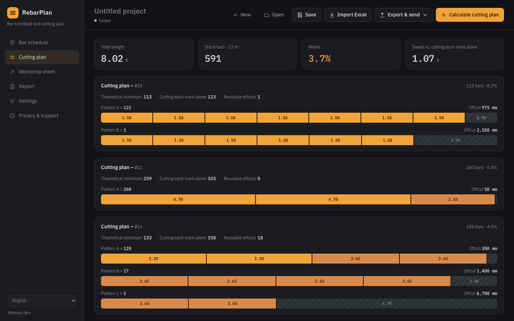

<p align="center"></p>

<h1 align="center">RebarPlan</h1>

<p align="center">Bar bending schedule and rebar cutting optimiser for Windows and Mac.<br>
Arabic · English · 简体中文 — free, offline, open source.</p>

<p align="center"><a href="https://apps.microsoft.com/detail/9PM9HL3XFBZ3?mode=direct"></a></p>

<p align="center"><a href="https://github.com/UKDean/RebarPlan/releases/latest"><b>Download for Windows or Mac</b></a> · <a href="https://mashharawi.com/tools/rebarplan/">Website</a> · <a href="PRIVACY.md">Privacy &amp; support</a></p>

<p align="center"></p>

## What it does

- **Bar bending schedule.** Enter bar marks by shape and dimensions, or import your schedule from Excel. Cut lengths follow **BS 8666:2005** (shape codes 00, 11, 21, 51) or **ACI 318 / Saudi SBC 304** (out-to-out legs, centreline length with ACI bend diameters). Legs shorter than the BS 8666 minimum end projection are flagged.
- **Cutting plan.** For each diameter it finds the cutting patterns that use the fewest stock bars, with 12 m bars or any mix of 6, 9, 12 and 18 m. On test schedules the plan is never more than one bar above the LP lower bound, and usually equal to it.
- **Cost.** Enter a price per tonne to see the steel cost and how much the plan saves against cutting each mark on its own.
- **Workshop sheet and labels.** A printable list for the cutting operator ("bars 1–120: cut 3.20 × 2 + 2.65 × 2, scrap 0.30") and labels for each bundle.
- **Rebar weights.** Weight per metre, per bar and per order for every diameter, a reference table of bars per tonne, and a weight list that can take the whole bar schedule and export to Excel.
- **Export.** Excel (schedule, summary by diameter, cutting plan), PDF through the Windows print dialog, or **send by email** with the Excel file attached.
- **Private.** Everything runs on your computer. No account, no tracking. See [PRIVACY.md](PRIVACY.md).

## Install

- **Windows:** install from the [Microsoft Store](https://apps.microsoft.com/detail/9PM9HL3XFBZ3) (recommended, no warnings), or download `RebarPlan_x.y.z_x64-setup.exe` from [Releases](https://github.com/UKDean/RebarPlan/releases/latest). The direct installer is not code-signed yet, so SmartScreen may warn: choose **More info → Run anyway**.
- **Mac:** download `RebarPlan_x.y.z_universal.dmg` from [Releases](https://github.com/UKDean/RebarPlan/releases/latest). It is signed and notarized by Apple. Mac App Store version coming soon.

## Build from source

Requires Node 22 and Rust (stable).

```bash
npm ci
npm test          # cutting and schedule tests
npx tauri dev     # run the app
npx tauri build   # build the installer
```

Signed macOS builds and the Mac App Store package: see [docs/APPSTORE.md](docs/APPSTORE.md) and `scripts/macos-release.sh`. Microsoft Store package: see [docs/MSSTORE.md](docs/MSSTORE.md).

The interface is plain HTML, CSS and JavaScript in `src/`; the cutting algorithm is `src/js/optimizer.js` and the shapes and weights are in `src/js/bbs.js`. The Windows shell is [Tauri 2](https://tauri.app) in `src-tauri/`.

## How the cutting plan works

Pieces of each diameter are packed into stock bars by a sequential heuristic: repeatedly take the pattern that best fills one bar (a bounded knapsack over the remaining demand, scoring pieces by length^p so long pieces go first), repeat it as often as demand allows, and continue. Several values of p and best-fit decreasing are tried and the plan with the fewest bars wins. The Martello–Toth bound is reported as the theoretical minimum.

## Licence

MIT © Omar Mashharawi. Fonts: IBM Plex (SIL Open Font License). Excel support: [SheetJS](https://sheetjs.com) Community Edition (Apache 2.0).

---

<div dir="rtl">

## بالعربي

**RebarPlan** برنامج مجاني ومفتوح المصدر لويندوز، يجمع **جدول تفريد الحديد** و**خطة القص المثلى** في تطبيق واحد، بالعربية والإنجليزية والصينية.

- أدخل العلامات بالأشكال والأبعاد أو استوردها من Excel، فيحسب طول القص حسب BS 8666 أو ACI والكود السعودي، والوزن لكل قطر.
- يحسب أفضل طريقة لقص الأسياخ (12 م أو أطوال متعددة) بأقل هدر، ويعرض الوفر بالطن وبالريال.
- ورقة جاهزة لعامل القص وملصقات للحزم.
- حاسبة أوزان الحديد: الوزن لكل متر وللسيخ وللطلبية، وعدد الأسياخ في الطن لكل قطر.
- تصدير Excel وPDF، أو إرسال الملف بالإيميل مباشرة.
- يعمل بدون إنترنت، بدون حساب أو تتبع.

للدعم: info@mashharawi.com

</div>
